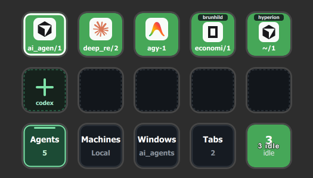
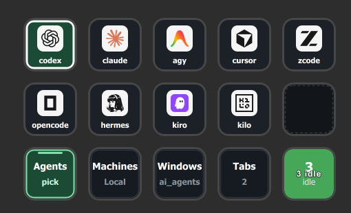

# herdr-stream-deck

Control [herdr](https://herdr.dev) — your herd of AI coding agents — from Elgato Stream Deck keys. Works with herdr running locally, in WSL, on a remote Linux box over SSH, or inside a Docker container (local or reached over SSH).

## Screenshots

| Live Agents View (Local + Remote Machines) | New Agent Picker (`+` Button) |
|---|---|
|  |  |

## Actions

### Dynamic 5×3 Deck View
- **Deck Slot** — place up to 10 slots on the top two rows; they dynamically display live agents (across Local + all enabled SSH machines), machines, windows (workspaces), or tabs depending on the active bottom-row mode. In Agents view, the first empty slot shows **`+`** (tap to pick a coding agent; long-press to start your default agent in a new tab).
- **List Agents / List Machines / List Windows / List Tabs** — bottom-row mode buttons with live counts and active machine/window labels.

### Standalone Keys
- **Fleet Status** — live counts of agents by state (blocked / working / done / idle). The key colors by the most urgent state; press to refresh.
- **Agent Command** — tap sends a prompt (or keystrokes) to an agent; long-press (≥600 ms) sends an interrupt (`ctrl+c` by default). With no agent pinned, it auto-targets the agent that needs attention — blocked first.
- **Agent Focus** — pins a single agent by name or pane ID and focuses its tab on press.
- **Spawn Agent** — splits a pane in herdr and starts a coding agent in it (`claude`, `codex`, `cursor`, `agy`, …).

## Install (development)

Requires [Node.js 20+](https://nodejs.org) and the Stream Deck app 6.9+.

```bash
npm install
npm run build
npx streamdeck link dev.hevangel.herdr.sdPlugin   # dev-install (symlink)
```

The actions appear under the *herdr* category. Open a key's settings to configure **connection profiles** — where the herdr CLI lives:

| kind | example |
|---|---|
| `local` | herdr on this machine |
| `wsl` | herdr inside a WSL distro (`"distro": "Ubuntu"`) |
| `machine` | herdr's native SSH machines (`herdr machine add …`, then `"machine": "gpu-box"`) |
| `docker` | herdr in a local container (`"container": "herdr"`) |
| `ssh` | herdr on a remote host (`"sshHost": "you@vps"`) |
| `ssh-docker` | herdr in a container on a remote host (`"sshHost": "you@vps"`, `"container": "herdr"`) |
| `custom` | any wrapper command (`"prefix": "toolbox exec"`) |

## Scripts

```bash
npm run build      # build the plugin
npm run watch      # rebuild + hot-reload while Stream Deck runs
npm run validate   # official manifest/plugin validation
npm run pack       # distributable .streamDeckPlugin into dist/
```

Logs land in `%APPDATA%\Elgato\StreamDeck\logs\` and `dev.hevangel.herdr.sdPlugin/logs/`.

## License

MIT — see [LICENSE](LICENSE).
